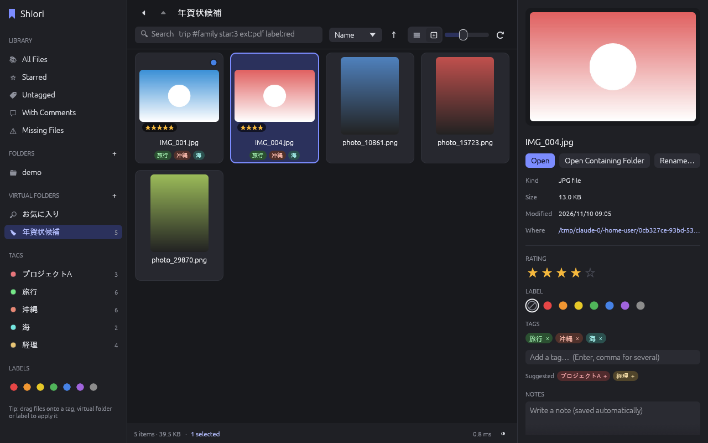
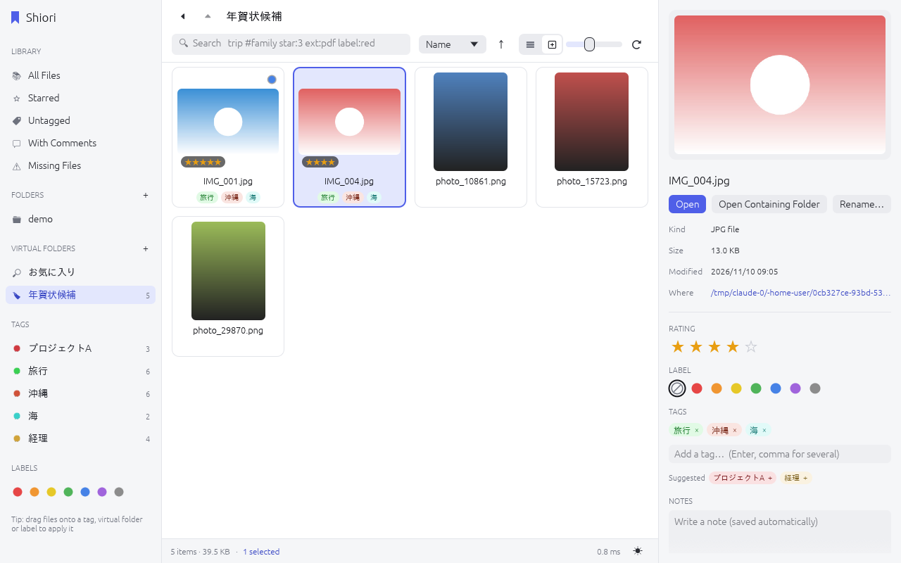

# 栞 Shiori

タグ・スター・ラベル・コメントでファイルを整理する、Windows / macOS 用のファイル管理ソフトです。Rust 製。画面のメニューは英語表示です（タグ名やコメントなど中身は日本語もそのまま使えます）。
フォルダの実際の構成はそのままに、「仮想フォルダ」でファイルを自由に集めたり、検索条件で自動的に集めたりできます。



<details><summary>ライトテーマ</summary>



</details>

## できること

| 機能 | 内容 |
| --- | --- |
| フォルダ登録 | 管理したいフォルダを登録すると、中身をバックグラウンドで索引化します（起動時に自動で再スキャン）。フォルダ名を右クリック →「Remove from Shiori」で登録解除（ディスク上のファイルはそのまま。タグ等を付けたファイルの情報は残ります） |
| フォルダ閲覧 | パンくずリスト・上へ・戻る・ダブルクリックで移動。「Include subfolders」で配下をまとめて表示 |
| タグ | 複数付与、カンマ区切りで一括入力、候補から選択、名前変更（既存タグ名にすると統合）、削除 |
| スター | 0〜5。数字キー 0〜5 でも設定可 |
| ラベル | 7色のカラーラベル |
| コメント | ファイルごとのメモ（検索対象） |
| 仮想フォルダ | 実フォルダと無関係にファイルを集める。右クリックやドラッグで追加 |
| スマートフォルダ | 検索条件を保存した仮想フォルダ。中身は自動で決まる |
| 検索・絞り込み | 下記の検索構文。インデックス済みなので数万件でも即座に結果が出ます |
| 表示 | リスト表示 / サムネイル表示（サイズ可変）。画像・PDF・動画・Office文書・HEICなどはサムネイルとプレビュー付き（Mac は Quick Look、Windows はエクスプローラーのサムネイル機能を利用） |
| テーマ | ライト / ダーク / OS に合わせる。右下のボタンで切り替え |
| ドラッグ＆ドロップ | ファイルを左のタグ・仮想フォルダ・ラベルへドラッグで付与。OSからウィンドウへのドロップで登録 |
| ファイル操作 | 開く、Finder/エクスプローラーで表示、名前変更（タグ等は引き継ぎ）、ゴミ箱へ移動、パスのコピー |
| 消えたファイル | タグなどを付けたファイルがディスクから消えても情報は残し「Missing Files」に表示 |

## 検索構文

```
旅行 #家族 -#ボツ star:3 label:red ext:jpg,png is:untagged
```

| 書き方 | 意味 |
| --- | --- |
| `言葉` | ファイル名かコメントに含む（複数はすべて含む） |
| `-言葉` | 含まない |
| `#タグ` / `tag:タグ` | タグが付いている（`-#タグ` で除外） |
| `star:3` / `★3` | スター3以上 |
| `label:red` / `label:赤` | ラベル（`label:red,blue` でどちらか） |
| `ext:jpg,png` | 拡張子 |
| `is:untagged` `is:tagged` `is:comment` `is:dir` `is:file` `is:missing` | 状態で絞り込み |
| `"空白 を含む 言葉"` | そのまま一致 |

左サイドバーのタグは、クリックでそのタグに絞り込み、⌘/Ctrl+クリックで条件を追加します。

## キーボード

| キー | 動作 |
| --- | --- |
| ↑ ↓ | 選択を移動 |
| Enter | 開く（フォルダなら中へ） |
| Backspace / Alt+↑ | 上のフォルダへ |
| 0〜5 | スター |
| F2 | 名前を変更 |
| Delete / ⌘+Backspace | ゴミ箱へ |
| ⌘/Ctrl+A | すべて選択 |
| ⌘/Ctrl+F | 検索欄へ |

## ビルド

Rust（stable）が必要です。https://rustup.rs からインストールできます。

```sh
cargo run --release          # 起動
cargo test                   # テスト
```

macOS の `.app` を作る場合:

```sh
cargo install cargo-bundle
cargo bundle --release       # target/release/bundle/osx/Shiori.app
```

Windows では `cargo build --release` で `target\release\shiori.exe` ができます。
アプリアイコンは Windows では `build.rs` が exe に埋め込み、macOS では `cargo bundle` が `Shiori.app` に入れます。
アイコンを直すときは `assets/icon/shiori.svg` を編集して `python3 assets/icon/build_icons.py`（cairosvg と Pillow が必要）で `.ico` / `.icns` / `.png` を作り直します。
GitHub に置くと `.github/workflows/build.yml` が Windows(x64) / macOS(Apple Silicon) 向けの配布用 zip を自動で作ります。

## データの保存場所

タグなどの情報は SQLite データベースに保存され、元のファイルには一切書き込みません。

- macOS: `~/Library/Application Support/dev.shiori.Shiori/shiori.db`
- Windows: `%APPDATA%\shiori\Shiori\data\shiori.db`

環境変数 `SHIORI_DB` で別の場所を指定できます。

## 構成

| ファイル | 役割 |
| --- | --- |
| `src/db.rs` | SQLite スキーマとデータ操作（タグ・スター・ラベル・コメント・仮想フォルダ・名前変更） |
| `src/query.rs` | 検索構文のパーサと SQL 変換 |
| `src/scan.rs` | フォルダのバックグラウンド索引化 |
| `src/thumbs.rs` | サムネイル生成（ワーカースレッド、表示中のものを優先） |
| `src/app.rs` | 画面（egui） |
| `src/theme.rs` | 配色・余白・文字サイズと、共通の部品（サイドバー項目、タグのチップなど） |
| `src/fonts.rs` | OS の日本語フォントの読み込み |
| `src/tests.rs` | 結合テスト |
| `assets/icon/` | アプリアイコン（元絵の `shiori.svg` と、そこから作る `.ico` / `.icns` / `.png`） |
| `build.rs` | Windows の exe にアイコンを埋め込む |

技術: [egui / eframe](https://github.com/emilk/egui)（GUI）、[rusqlite](https://github.com/rusqlite/rusqlite)（SQLite 同梱）、walkdir、image、rfd、trash
